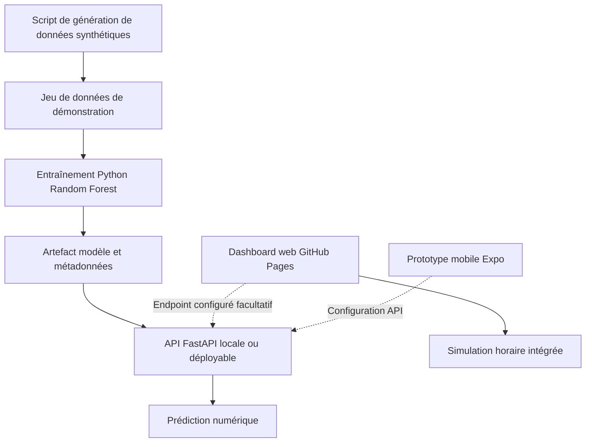
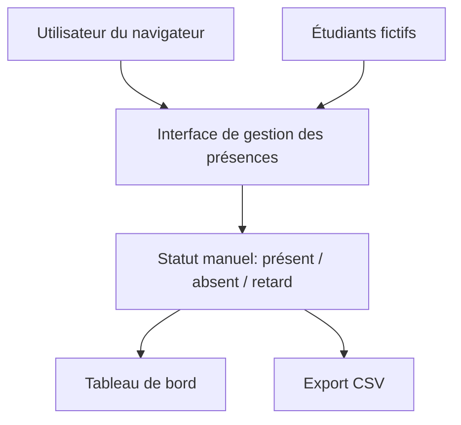
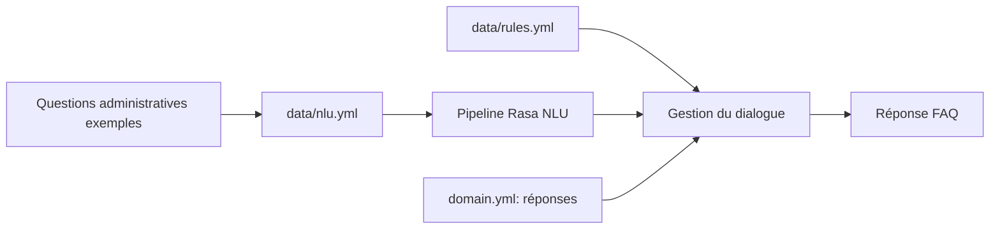
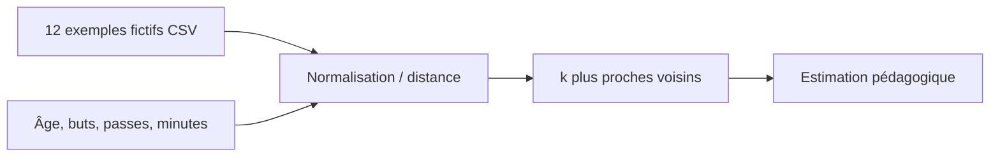
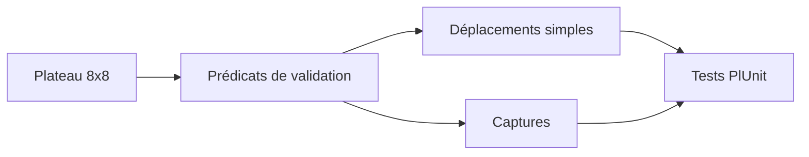

# Architectures des prototypes — Master ISI

> Les diagrammes ci-dessous décrivent les prototypes **présents dans ces dépôts**, et non des architectures de production. Ils ne prouvent pas que des services externes sont déployés.

## 1. TrafficFlow AI — prototype à données synthétiques

**Vérifiable :** source Python, tests du modèle/API et interface web avec simulation. **Non revendiqué :** données routières temps réel, backend actuellement hébergé, application mobile publiée, précision sur données réelles.

## 2. Smart Attendance — démonstration web

**Important :** cette version GitHub Pages n'utilise ni caméra ni reconnaissance faciale. Le prototype Python/OpenCV antérieur doit être récupéré et audité séparément avant toute revendication de détection réelle.

## 3. Chatbot Rasa — dépôt séparé

**Vérifiable :** fichiers de configuration et scénarios de test. **Non revendiqué :** modèle entraîné, données officielles d'une école, intégration avec un système scolaire, déploiement public.

## 4. Football Value Predictor — reconstruction pédagogique

Ce prototype n'est pas un modèle de valorisation professionnelle; ses données fictives ne permettent pas de mesurer une performance de marché.

## 5. Jeu de dames Prolog — règles simplifiées

Le jeu ne couvre pas toutes les règles des dames internationales.

## Recommandations pour la soutenance

Pour chaque projet, présenter **problème → architecture → implémentation → démonstration → tests → limites → perspectives**. Ajouter de vraies captures d'écran uniquement après avoir exécuté l'application. Éviter toute capture simulée présentée comme une preuve de fonctionnement.
